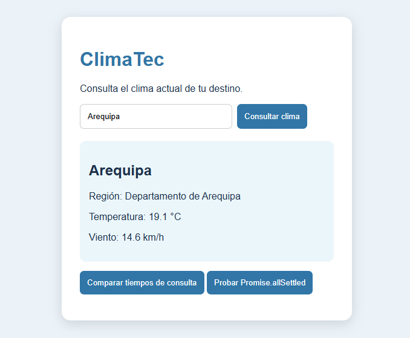
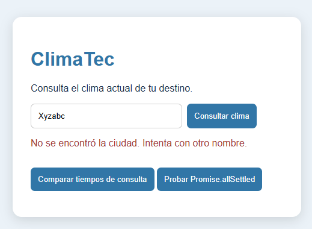
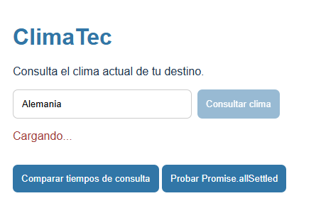
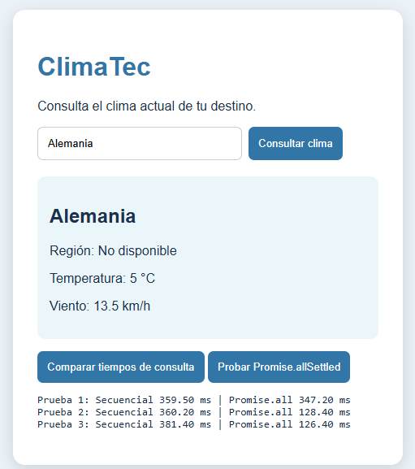
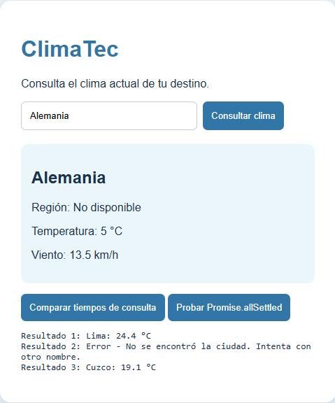
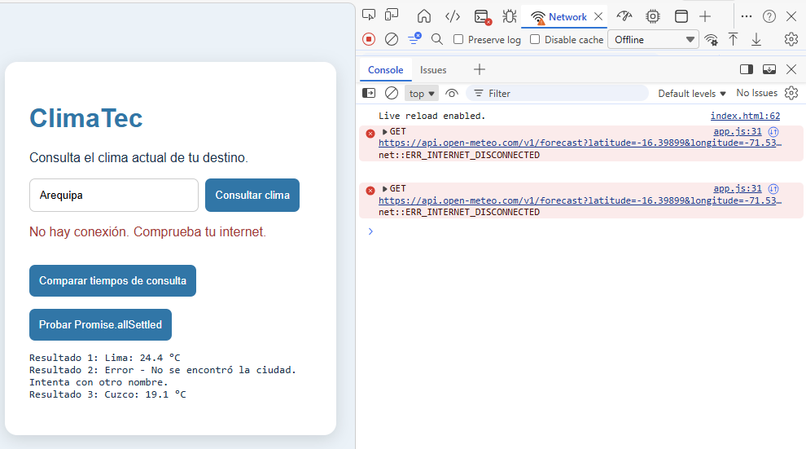
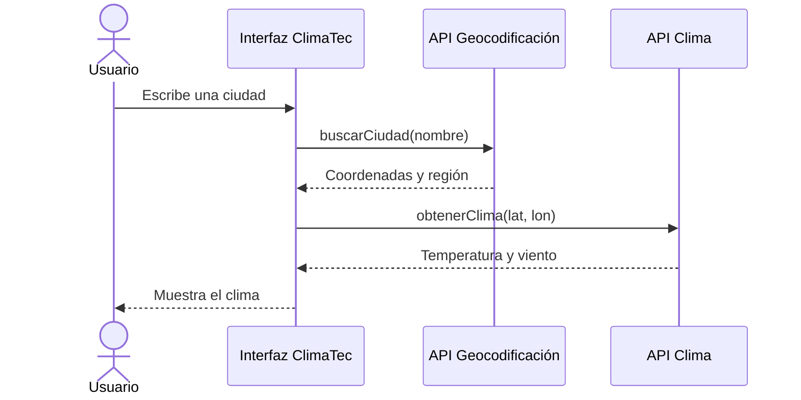

## Tabla de contenidos

- [Pregunta 1: Eventos del DOM](#pregunta-1-análisis-de-eventos-del-dom)
- [Pregunta 2: JavaScript ES6+](#pregunta-2-javascript-moderno-es6--sintaxis-avanzada-y-módulos)
- [Pregunta 3: Fetch y async/await](#pregunta-3-consumo-de-apis-con-fetch-y-asyncawait)
- [Pregunta 4: Repositorio y bitácora](#pregunta-4-repositorio-readme-y-bitácora-de-ia)
- [Conclusión](#6-conclusión)

## Pregunta 1: Análisis de eventos del DOM

### Descripción

En esta actividad se desarrolló un sistema de registro de pedidos para la cafetería CaféTec. Se trabajó con eventos del DOM, objetos, arreglos y manipulación de elementos HTML mediante JavaScript.

### Tabla de eventos

| Elemento | Evento | Acción |
| :--- | :--- | :--- |
| `#form-pedido` | `submit` | Valida los datos y registra un nuevo pedido utilizando `preventDefault()`. |
| `#filtro` | `change` | Actualiza la lista según el estado seleccionado. |
| `#lista-pedidos` | `click` | Permite entregar o eliminar pedidos mediante delegación de eventos. |

### Análisis

Se identificaron tres eventos principales para las interacciones del usuario: `submit`, `change` y `click`.

El evento `submit` permite registrar pedidos sin recargar la página. El evento `change` actualiza la visualización según el filtro seleccionado y el evento `click` permite ejecutar acciones sobre los pedidos.

Para administrar los botones de entregar y eliminar se utilizó delegación de eventos, colocando un único listener en el elemento `#lista-pedidos`.

### Estructura e implementación

Se crearon tres archivos para organizar el desarrollo:

- `index.html`: contiene la estructura de la aplicación.
- `styles.css`: contiene los estilos de la interfaz.
- `script.js`: contiene la lógica y las interacciones de la aplicación.

Se utilizó el atributo `defer` para ejecutar JavaScript después de analizar el documento HTML.

Para representar los pedidos se creó la clase `Pedido`, con las propiedades `id`, `producto`, `precio`, `cantidad` y `estado`. También se implementaron los métodos `subtotal()` y `marcarEntregado()`.

Se utilizó un arreglo para almacenar los pedidos y una función `render()` para actualizar la lista y calcular el total cada vez que se realiza un cambio.

### Validaciones

Se implementaron validaciones para evitar registrar productos sin nombre, precios menores o iguales a cero y cantidades negativas.

Se utilizó `preventDefault()` para evitar que el formulario recargue la página y `novalidate` para controlar los mensajes de validación mediante JavaScript.

### Funcionalidades implementadas

- Registrar nuevos pedidos.
- Calcular el subtotal de cada pedido.
- Actualizar el total general.
- Marcar pedidos como entregados.
- Eliminar pedidos.
- Filtrar pedidos por estado: todos, pendientes y entregados.

### Delegación de eventos

Se utilizó un único evento `click` en `#lista-pedidos` para controlar los botones Entregar y Eliminar.

Esta técnica permite administrar los eventos desde un elemento padre, evitando agregar un listener individual a cada botón.

### Prueba de seguridad

Se realizó una prueba utilizando el siguiente texto como nombre de producto:

```html

```

El contenido se mostró literalmente en la lista y no se ejecutó ninguna alerta.

Se decidió utilizar `textContent` para mostrar los nombres de los productos, ya que permite tratarlos como texto y evita que el navegador interprete las etiquetas HTML ingresadas por el usuario.

En cambio, `innerHTML` interpreta el contenido como HTML y puede generar riesgos si se utiliza directamente con datos no confiables.

Por este motivo, se conservó `textContent` en la implementación.

### Diseño de la interfaz

Se personalizó la interfaz de CaféTec utilizando una paleta de cinco colores: `#1F1412`, `#3C2724`, `#6B3F2A`, `#C79B53` y `#F3E6C6`.

Se utilizó CSS para crear un diseño adaptable, con tarjetas, botones personalizados y efectos visuales.

También se implementaron animaciones de aparición mediante `IntersectionObserver`, permitiendo que los elementos se muestren suavemente al desplazarse por la página.

### Evidencias

**Interfaz inicial**


**Conexión de JavaScript**


**Animaciones al desplazarse**


**Prueba de seguridad con innerHTML**


**Prueba de seguridad con textContent**


### Comprobaciones realizadas

Se verificó el registro de pedidos, las validaciones, el funcionamiento de los botones y el filtrado por estado. También se comprobó que los identificadores originales del HTML se mantuvieran y que la consola no presentara errores durante las pruebas.

### Bitácora de uso de IA – Pregunta 1

| # | Pregunta | IA usada | ¿Qué propuso la IA? | Decisión | ¿Por qué? |
| :--- | :--- | :--- | :--- | :--- | :--- |
| 1 | P1 | ChatGPT | Generar una función `render()` para mostrar pedidos, aplicar filtros y calcular el total mediante `reduce()`. | Corregí y amplié | La propuesta servía como base, pero agregué los botones de entregar y eliminar, los estados y las clases necesarias para mantener el diseño de CaféTec. Verifiqué el funcionamiento registrando, filtrando y eliminando pedidos. |
| 2 | P1 | ChatGPT | Utilizar `createElement()` y `textContent` para mostrar los datos ingresados por el usuario de forma segura. | Acepté | Mantuve esta forma de insertar los nombres de los productos y realicé una prueba con el texto ``. Comprobé que se mostraba como texto y que no se ejecutaba ninguna alerta. |

### Comparación entre textContent e innerHTML

Para comprobar la diferencia entre ambas propiedades, se analizó cómo insertan el contenido ingresado por el usuario.

- `textContent`: muestra el contenido como texto, por lo que no interpreta las etiquetas HTML.
- `innerHTML`: interpreta el contenido como HTML, lo que puede permitir la ejecución de código malicioso si se utiliza con datos no confiables.

En la prueba realizada con el texto ``, se comprobó que `textContent` lo mostraba literalmente, sin ejecutar ninguna alerta.

Por seguridad, se decidió conservar `textContent` en la función `render()`, evitando que los datos ingresados por los usuarios sean interpretados como código HTML.

## Pregunta 2: JavaScript moderno ES6+ – Sintaxis avanzada y módulos

### Descripción

En esta actividad se realizó la actualización de un código JavaScript antiguo a una versión moderna utilizando características de ES6+. También se trabajó con clases, módulos y exportación e importación de funciones para organizar mejor el código.

### 1. Cálculo manual y análisis del código antiguo

El código original utiliza `var` y el operador `||` para asignar una cantidad predeterminada de 1 cuando no existe una cantidad registrada.

Sin embargo, esta condición presenta un problema porque considera que el valor `0` también debe reemplazarse por 1.

Para comprobarlo, se realizó el cálculo manual:

| Producto | Precio | Cantidad | Subtotal |
| :--- | ---: | ---: | ---: |
| Café | S/ 6.00 | 2 | S/ 12.00 |
| Croissant | S/ 4.50 | 0 | S/ 0.00 |
| Jugo | S/ 8.00 | 1 | S/ 8.00 |
| **Subtotal** | | | **S/ 20.00** |

Cálculo del IGV:

- Subtotal: S/ 20.00
- IGV (18 %): S/ 3.60
- Total: S/ 23.60

Al ejecutar el código antiguo, el resultado es S/ 28.91, porque el operador `||` reemplaza la cantidad 0 del Croissant por 1.

Por este motivo, se utilizó el operador `??`, que conserva el valor 0 y asigna 1 únicamente cuando la cantidad es `null` o `undefined`.

### 2. Refactorización con ES6+

Se actualizaron las declaraciones de variables, funciones y operaciones utilizando características modernas de JavaScript.

El cálculo del total quedó de la siguiente manera:

```js
export const IGV = 0.18;

export const calcularTotal = (pedidos) => {
    const subtotal = pedidos.reduce((total, pedido) => {
        const { precio, cantidad = 1 } = pedido;
        return total + precio * (cantidad ?? 1);
    }, 0);

    return subtotal + subtotal * IGV;
};
```

También se implementó la función para generar el resumen de cada pedido:

```js
export const resumen = (pedido) => {
    const { producto, cantidad = 1, cliente } = pedido;
    const nombre = cliente?.nombre ?? "Anónimo";

    return `Pedido de ${nombre}: ${producto} x${cantidad}`;
};
```

Se comprobó el resultado utilizando el arreglo de pedidos del enunciado. El total obtenido fue S/ 23.60 y los resúmenes mostraron correctamente los nombres de los clientes o el valor predeterminado "Anónimo".

### 3. Tabla de características ES6+

| Característica ES6+ | Dónde se utilizó | ¿Por qué? |
| :--- | :--- | :--- |
| `const` y `let` | En `pedidos.js` y `main.js`. | Permiten declarar variables según si necesitan reasignarse o no. |
| Funciones flecha | En `calcularTotal()`, `resumen()` y otras funciones. | Simplifican la escritura de funciones. |
| Template literals | En los mensajes y resúmenes. | Permiten insertar variables dentro de cadenas de texto. |
| Destructuring | En `calcularTotal()` y `resumen()`. | Facilita extraer propiedades de los objetos. |
| `reduce()` | En `calcularTotal()` y el cálculo del total mostrado en la interfaz. | Permite acumular los subtotales de los pedidos. |
| Optional chaining `?.` | En `cliente?.nombre`. | Evita errores cuando el cliente no tiene información registrada. |
| Nullish coalescing `??` | En la cantidad y el nombre del cliente. | Permite asignar valores predeterminados sin reemplazar el cero. |
| Clases | En la clase `Pedido`. | Permiten organizar las propiedades y métodos de los pedidos. |
| Spread `...` | En `marcarEntregado()` y la actualización del arreglo. | Permite crear nuevos objetos y arreglos sin modificar los originales. |
| Módulos | En `pedidos.js`, `ui.js` y `main.js`. | Permiten separar las responsabilidades del código. |

### 4. Implementación de la clase Pedido y spread

Se convirtió el modelo de pedidos en una clase llamada `Pedido`, que contiene las propiedades y métodos necesarios para administrar cada registro.

```js
export default class Pedido {
    constructor({ id, producto, precio, cantidad, estado = "pendiente", cliente = null }) {
        this.id = id;
        this.producto = producto;
        this.precio = precio;
        this.cantidad = cantidad;
        this.estado = estado;
        this.cliente = cliente;
    }

    subtotal() {
        return this.precio * (this.cantidad ?? 1);
    }

    marcarEntregado() {
        return new Pedido({ ...this, estado: "entregado" });
    }
}
```

Se utilizó spread para crear un nuevo objeto con los mismos datos del pedido, cambiando únicamente su estado a "entregado".

También se utilizó spread para agregar pedidos al arreglo sin modificar el arreglo original:

```js
pedidos = [...pedidos, nuevoPedido];
```

Para actualizar el estado de los pedidos se utilizó `map()`, mientras que para eliminarlos se utilizó `filter()`.

### 5. Organización mediante módulos

El código se dividió en tres archivos JavaScript para mantener una mejor organización:

- **pedidos.js:** contiene la clase `Pedido`, el IGV, las funciones de cálculo y los pedidos de ejemplo.
- **ui.js:** contiene la función `render()`, encargada de actualizar la lista de pedidos y el total en la interfaz.
- **main.js:** importa las funciones y la clase necesarias, registra los eventos y conecta la lógica con los elementos HTML.

Para cargar el archivo principal se utilizó:

```html
<script type="module" src="./main.js"></script>
```

**Exportaciones utilizadas**

Se utilizó `export default` para la clase `Pedido`, porque es la clase principal del archivo y se importa como elemento principal.

También se utilizaron exportaciones nombradas (`export`) para las funciones y constantes, como `calcularTotal`, `resumen` e `IGV`, porque permiten importar específicamente los elementos necesarios.

En `ui.js` se utilizó una exportación nombrada para la función `render()`.

### 6. Prueba de ejecución con file:// y Live Server

Se abrió el archivo `index.html` directamente desde el explorador de archivos mediante `file://`.

Al realizar esta prueba, Google Chrome mostró un error de seguridad CORS al intentar cargar `main.js`. Esto ocurrió porque el navegador restringe la carga de módulos JavaScript cuando se ejecutan directamente desde archivos locales.

Como consecuencia, la estructura HTML y los estilos se mostraron, pero las funcionalidades de JavaScript no se ejecutaron.

Para solucionar este problema se utilizó Live Server desde Visual Studio Code, que permite ejecutar la página mediante HTTP y cargar correctamente los módulos.

**Comprobación:** al abrir el proyecto mediante Live Server se verificó que los cálculos, los eventos y las funcionalidades de los pedidos funcionaran correctamente.

### 7. Bitácora de uso de IA – Pregunta 2

| # | Pregunta | IA usada | ¿Qué propuso la IA? | Decisión | ¿Por qué? |
| :---: | :---: | :--- | :--- | :---: | :--- |
| 3 | P2 | Gemini | Refactorizar el código antiguo utilizando características ES6+, como funciones flecha, `reduce()`, `?.`, `??` y template literals. | Corrigió | Revisé el código propuesto y comprobé que faltaba destructuring, una característica solicitada en el enunciado. Agregué esa parte y verifiqué que el cálculo devolviera S/ 23.60. |
| 4 | P2 | ChatGPT | Explicó por qué los módulos JavaScript no se ejecutan al abrir directamente el HTML con `file://` y recomendó utilizar Live Server. | Aceptó | Comprobé el error CORS en la consola al abrir el archivo localmente. Después ejecuté el proyecto con Live Server y verifiqué que los módulos y las funcionalidades funcionaran correctamente. |

### 8. Evidencias

**Error al abrir el proyecto mediante file://**


**Refactorización generada por Gemini**


**Registro de pedidos**


**Pedido marcado como entregado**


**Filtro de pedidos**


**Comprobación del cálculo en consola**


### 9. Comprobaciones realizadas

Se verificó el cálculo del total con IGV, obteniendo S/ 23.60. También se comprobó que el valor 0 se conservara correctamente y que los pedidos sin cantidad utilizaran el valor predeterminado de 1.

Se revisó la separación de responsabilidades entre los tres módulos y el funcionamiento de las importaciones y exportaciones.

Finalmente, se comprobó que la aplicación pudiera registrar pedidos, marcarlos como entregados, eliminarlos y filtrarlos por estado utilizando Live Server.

## Pregunta 3: Consumo de APIs con Fetch y async/await

### 1. Descripción

En esta pregunta desarrollé **ClimaTec**, una aplicación que permite consultar el clima actual de diferentes ciudades del Perú mediante las API de Open-Meteo. Para obtener la información se realizan dos solicitudes: primero se busca la ciudad y sus coordenadas mediante Geocoding API; después, con esos datos, se consulta la temperatura y la velocidad del viento mediante Forecast API.

### 2. Documentación oficial de las API

Para desarrollar la aplicación revisé la documentación oficial de Open-Meteo y utilicé los siguientes parámetros y campos:

| API | Parámetros utilizados | Datos obtenidos |
|---|---|---|
| Geocoding | `name`, `count`, `language` | `name`, `latitude`, `longitude`, `admin1` |
| Forecast | `latitude`, `longitude`, `current` | `current.temperature_2m`, `current.wind_speed_10m` |

Documentación consultada:

- [Geocoding API](https://open-meteo.com/en/docs/geocoding-api)
- [Forecast API](https://open-meteo.com/en/docs)

### 3. Implementación con Fetch y async/await

Se crearon dos funciones asíncronas:

- `buscarCiudad(nombre)`: consulta la API de geocodificación y obtiene el nombre, la región y las coordenadas de la ciudad.
- `obtenerClima(lat, lon)`: utiliza las coordenadas para consultar la temperatura y la velocidad del viento.

La función `consultarClima(nombre)` ejecuta ambas solicitudes en orden, ya que primero se necesitan las coordenadas para consultar el clima.

En la interfaz se muestra el mensaje «Cargando...» mientras se realiza la consulta y se deshabilita el botón para evitar envíos repetidos. Al finalizar, se muestran los resultados o el mensaje de error correspondiente.

### 4. Manejo de errores

Se utilizaron las estructuras `try`, `catch` y `finally` para controlar los errores durante las solicitudes.

También se comprobó la propiedad `response.ok` antes de procesar la respuesta. Esto es importante porque `fetch()` no rechaza automáticamente la promesa cuando el servidor responde con errores HTTP como 404 o 500; por eso es necesario verificar el estado de la respuesta.

Se realizaron estas pruebas:

- **Ciudad inexistente:** al buscar `Xyzabc`, se muestra un mensaje indicando que no se encontró la ciudad.
- **Sin conexión:** al activar el modo Offline desde las herramientas del navegador, se muestra un mensaje para comprobar la conexión.
- **Consulta correcta:** al ingresar una ciudad válida, se muestran sus datos meteorológicos.

### 5. Comparación de consultas secuenciales y paralelas

Se compararon las consultas del clima de Lima, Cusco y Arequipa utilizando dos métodos. Las mediciones se realizaron tres veces con `performance.now()`.

- **Secuencial:** cada consulta espera a que termine la anterior.
- **Paralela:** `Promise.all()` permite ejecutar las tres consultas al mismo tiempo.

| Prueba | Secuencial (ms) | Promise.all (ms) |
|---|---:|---:|
| 1 | 370.70 | 241.40 |
| 2 | 360.20 | 128.30 |
| 3 | 609.00 | 152.40 |
| **Promedio** | **446.63** | **174.03** |

**Análisis:** En las tres pruebas, `Promise.all()` obtuvo un menor tiempo de ejecución. El promedio fue de 174.03 ms frente a 446.63 ms de las consultas secuenciales, lo que representa una reducción aproximada del 61 %. Esto demuestra que realizar solicitudes en paralelo puede ahorrar tiempo cuando no es necesario esperar el resultado de una consulta para iniciar otra.

### 6. Comparación entre Promise.all y Promise.allSettled

Se realizaron tres consultas utilizando Lima, Xyzabc y Cusco. La segunda ciudad se utilizó para comprobar el comportamiento cuando una consulta falla.

Los resultados obtenidos fueron:

```text
Resultado 1: Lima: 24.4 °C
Resultado 2: Error - No se encontró la ciudad. Intenta con otro nombre.
Resultado 3: Cuzco: 19.1 °C
```

En esta prueba, `Promise.allSettled()` permitió obtener el resultado individual de cada consulta, incluso cuando una de ellas falló. Así, se conservaron los resultados de Lima y Cuzco y también se mostró el error de Xyzabc.

A diferencia de `Promise.all()`, que rechaza la operación completa cuando una promesa falla, `Promise.allSettled()` espera a que todas terminen y permite identificar cuáles fueron exitosas y cuáles tuvieron errores.

### 7. Evidencias

**Consulta correcta del clima**



**Búsqueda de una ciudad inexistente**



**Mensaje de carga durante la consulta**



**Comparación de tiempos de ejecución**



**Prueba con Promise.allSettled**



**Prueba sin conexión a internet**


## Pregunta 4: Repositorio, README y bitácora de IA

### 1. Repositorio

El proyecto se encuentra organizado en tres carpetas principales, una para cada pregunta:

- `p1-dom/`: eventos y manipulación del DOM.
- `p2-modulos/`: características de ES6+ y módulos JavaScript.
- `p3-api/`: consumo de API mediante Fetch y async/await.
- `img/`: capturas de las pruebas realizadas.

**Repositorio:** [evaluacion03-js en GitHub](https://github.com/cuentaparaestudios453-ops/evaluacion03-js)

**GitHub Pages:** [Enlace del proyecto](https://cuentaparaestudios453-ops.github.io/evaluacion03-js/)

> El enlace de GitHub Pages debe comprobarse después de configurar la publicación desde Settings → Pages.

### 2. Badges


### 3. Diagrama del funcionamiento de la Pregunta 3

El siguiente diagrama representa el recorrido de una consulta del clima desde que el usuario ingresa una ciudad hasta que se muestran los resultados.



### 4. Bitácora de uso de inteligencia artificial

| # | Pregunta | IA usada | ¿Qué propuso la IA? | Decisión | ¿Por qué? |
|---|---|---|---|---|---|
| 1 | P1 | ChatGPT | Organizar la actualización de pedidos y el cálculo del total mediante una función `render()`. | Corrigió | Probé el registro, filtrado y eliminación de pedidos y adapté la función para actualizar también sus estados. |
| 2 | P1 | ChatGPT | Utilizar `createElement()` y `textContent` para mostrar datos de forma segura. | Aceptó | Probé ingresando código HTML como texto y verifiqué que no se ejecutara como contenido HTML. |
| 3 | P2 | Gemini | Refactorizar el código utilizando características modernas de JavaScript. | Corrigió | Revisé el código y añadí la desestructuración que faltaba. También comprobé el cálculo del total, que debía ser S/ 23.60. |
| 4 | P2 | ChatGPT | Explicar el error CORS al abrir módulos desde `file://` y utilizar Live Server. | Aceptó | Comprobé el error en la consola del navegador y verifiqué que los módulos funcionaran al abrir el proyecto mediante Live Server. |
| 5 | P3 | ChatGPT | Separar las consultas de geocodificación y clima mediante funciones asíncronas. | Aceptó | Probé la búsqueda de ciudades válidas y una ciudad inexistente, comprobando los datos recibidos y los mensajes mostrados. |
| 6 | P3 | ChatGPT | Implementar las pruebas de ejecución secuencial, paralela y manejo de resultados con `Promise.allSettled()`. | Aceptó | Ejecuté las tres mediciones y comprobé que `Promise.allSettled()` mostrara los resultados correctos y el error de la ciudad inexistente. |

### 5. Lista de tareas

- [x] Crear el repositorio `evaluacion03-js`.
- [x] Organizar las carpetas de las preguntas.
- [x] Desarrollar la Pregunta 1: eventos del DOM.
- [x] Desarrollar la Pregunta 2: ES6+ y módulos.
- [x] Desarrollar la Pregunta 3: Fetch y async/await.
- [x] Realizar pruebas y guardar evidencias.
- [x] Documentar las tres preguntas en el README.
- [x] Incluir la bitácora con seis entradas.
- [x] Agregar badges y tabla de contenidos.
- [x] Agregar el diagrama Mermaid.
- [ ] Comprobar que GitHub Pages esté publicado.
- [ ] Verificar que existan al menos seis commits progresivos.

### 6. Conclusión

Durante el desarrollo de esta evaluación pude aplicar diferentes características de JavaScript en situaciones prácticas. En la primera pregunta trabajé con eventos del DOM y decidí utilizar delegación de eventos para gestionar las acciones de los pedidos desde un solo elemento. También utilicé `textContent` en lugar de `innerHTML` para mostrar datos ingresados por el usuario de forma más segura.

En la segunda pregunta utilicé módulos para separar las responsabilidades del programa y características de ES6+, como clases, desestructuración, operador spread y funciones flecha. Una decisión importante fue utilizar `??` en lugar de `||`, porque necesitaba conservar el valor cero de la cantidad de un pedido.

En la tercera pregunta trabajé con Fetch y async/await para consultar información de Open-Meteo. Comprobé que las consultas paralelas con `Promise.all()` podían reducir el tiempo de espera y que `Promise.allSettled()` permitía conservar los resultados aunque una consulta fallara.

La inteligencia artificial fue útil como apoyo para organizar el código, comprender errores y proponer mejoras. Sin embargo, no acepté todas sus sugerencias sin revisarlas. Verifiqué los resultados mediante pruebas en el navegador, la consola y la documentación de las API. De esta manera, las decisiones finales sobre la implementación y las correcciones fueron realizadas a partir del funcionamiento del propio proyecto.

Además, las pruebas me ayudaron a identificar que no todas las propuestas funcionan correctamente desde el primer intento. Tuve que revisar algunos detalles, corregir la lógica y comprobar los resultados antes de conservarlos. Considero que la IA fue útil para resolver dudas y orientar el desarrollo, pero las pruebas y las decisiones finales dependieron de mi revisión del código.